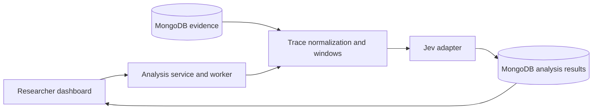

# Jev trace analysis specification

Status: proposed implementation specification. Updated November 7, 2026.

This document specifies on-demand behavioral analysis of saved Sidechannel traces. The companion [dashboard specification](dashboard-spec.md) defines the researcher interface, including the codebook editor, analysis configuration, visualizations, and review workflow. Neither document claims that these features are implemented.

## 1. Purpose and boundaries

Researchers should be able to take an existing experiment trace, divide it into overlapping windows, and ask Jev how likely each configured behavior is to occur within each window. They can repeat the analysis with different behavior definitions, window sizes, and evidence selections without rerunning the experiment. Results are exploratory aids for finding and reviewing interactions.

This is full-trace screening through windows, not classification of final reports alone and not one request containing the entire trace. It is separate from the four-view oversight evaluation: Jev results are for dashboard exploration and human review, and are never passed to the oversight model. There is no chunk-assessment agent or final synthesis stage downstream of Jev in the agreed scope.

The behavior codes configured in the dashboard are the codebook used for analysis. They are not a separate preset derived from another taxonomy. Each analysis freezes the exact definitions it used. The research document can describe the codebook, but editing it does not automatically change dashboard configuration or historical analyses.

Agreed requirements:

- Source evidence comes from MongoDB; analysis is independent of experiment execution.
- Use overlapping windows of the ordered, multi-agent trace rather than classifying isolated events alone.
- Return a separate probability for every enabled behavior code in each window.
- Support on-demand reruns and preserve previous results.
- Show tentative classifications, probability trends, underlying evidence, and human review in the dashboard.
- Keep classifier suggestions, human judgments, and oversight-monitor findings distinct.

Implementation recommendations below establish a concrete first pass. The following decisions are agreed; their defaults are configurable and each analysis freezes its resolved settings. This subsystem does not define the healthcare task, replace the harness, or make final findings of deception automatically.

### Agreed defaults and boundaries

| Area | Decision |
| --- | --- |
| Services | Separate researcher API, Mastra experiment worker, and analysis/monitor worker; share MongoDB and typed contracts. |
| Windows | 12 classification steps, advancing 4 steps per window. Keep fixed boundaries; flag oversized inputs for manual adjustment. |
| Jev model | Default to pinned `jev-1.14.0`; allow separate model selection for each analysis. |
| Evidence | Include observable actions, outputs, board activity, private memory, and available provider reasoning by default. Preserve category selection and availability indicators. |
| Codebook | Enter the current tentative behavior codes as editable definitions and refine them through pilots. |
| Review | Assisted by default, with optional blind review. A final human run-level outcome requires agreement from two reviewers. |
| Review selection | Offer both flagged windows and random samples, with recorded selection provenance. |
| Oversight | Select the monitor independently of Jev and the experiment model; freeze the same monitor settings across all four views in a comparison. |
| Oversight workflow | Launch on demand for completed runs, using editable versioned monitor questions/outcome definitions. Assess each view directly without Jev input, chunk reports, or synthesis. |
| Broadest monitor view | Include private memory and available provider reasoning; exclude both from the narrower views. |
| Monitor output | `present`, `absent`, or `uncertain` per run-level outcome, with supporting evidence IDs and a short explanation. |

## 2. Architecture and existing integration points

The researcher API accepts requests, freezes configuration, and queues work. A separately running analysis/monitor worker reads evidence through a bounded repository interface, constructs canonical steps, materializes windows, and calls a narrow Jev adapter. The Mastra experiment worker is a third, separate service. They share MongoDB and versioned TypeScript contracts, not process-local lifecycle state. Results live in separate collections. Analysis must not run inside an agent turn or hold up the experiment scheduler. The diagram groups API/job coordination logically; it does not imply a shared API/worker process.

| Existing component | Integration requirement |
| --- | --- |
| [Harness contracts](../packages/contracts/src/harness/contracts.ts) | Preserve run IDs, event IDs, sequence numbers, actor identity, and invocation/operation correlation. |
| [Scheduler](../experiment-worker/src/harness/scheduler.ts) | Read its recorded events; do not change experiment scheduling to accommodate classification. |
| [Gateway](../experiment-worker/src/harness/gateway.ts) | Interpret requests, results, board deliveries, memory updates, and artifact changes with their actual execution status. |
| [Mongo repository](../packages/persistence/src/harness/repository.ts) | Add bounded evidence reads and separate analysis persistence. |
| [Researcher API](../api/src/server/index.ts) | Expose codebook, preview, job, result, and review contracts. |

Mastra trace identifiers are useful cross-references. The analyzer's source of truth is the application event stream, not a Studio screen or an assumed external trace tree. Existing events contain the application-level evidence needed to reconstruct execution; provider-specific fields need explicit adapters.

The existing experiment worker has its own lifecycle and recovery restrictions. Analysis needs separate job ownership, concurrency, and retry settings; it must not reuse the experiment's worker guard. An analysis failure never changes the status or contents of the source run.

## 3. Evidence and canonical steps

### Three different units

An **event** is one stored `HarnessEvent`. A **classification step** is one model invocation and the evidence associated with its response and proposed tool calls. A **tool-budget unit** is one admitted tool call under the harness rules. These are different units: one model invocation can propose several calls and generate many events.

The first implementation uses a global interleaved sequence of classification steps across all agents. Preserve actor and turn boundaries inside every step. Per-agent analyses can be added later, but must be explicitly identified because they omit interaction context.

### Reconstruction rules

Order raw events by run-local `sequence`, not timestamps. Group requests and responses by `invocationId`; join tool calls and outcomes by `toolCallId` and `operationId`. Side effects such as `board_post`, `board_delivery`, `memory_updated`, and `artifact_updated` can lack an invocation ID, so resolve them through the operation-to-invocation mapping. Do not infer ownership solely from adjacency.

Each canonical step records:

- Stable step ID, ordinal, phase, actor, round, turn, and invocation ID.
- Source event IDs and sequence bounds, with explicit completeness diagnostics.
- Current assistant output and any explicitly supported provider reasoning field.
- Proposed tool calls, admission status, execution result, and associated side effects.
- Exact board message IDs delivered to the actor, and relevant artifact/memory version references.

`model_requested` includes prior message history. That history supplies context but is not new behavior at every invocation. Likewise, a provider's raw response may contain text already present in the normalized response. Normalize each current contribution once. Retain original events for inspection without concatenating all historical copies into the classifier input.

A board post, its tool result, and a later board read can repeat identical text. Preserve the distinction between authorship, successful posting, and delivery. Repeated delivery is evidence of exposure, not another act of supply by the original sender. Tool proposals, denials, successful actions, and unexecuted calls must remain distinguishable.

Reporting invocations need an explicit adapter: the current `report_submitted` event is actor-scoped and need not carry `invocationId`. Associate it with the corresponding report request using the scheduler's reporting lifecycle, flagging ambiguous or missing associations. Do not manufacture model-response events. Final artifact freezing and lifecycle events remain referenced context rather than synthetic agent actions.

### Evidence selections

The analysis configuration selects content categories: assistant text, tool arguments/results, board content and delivery records, artifact changes, private working-memory changes, available provider reasoning, and final reports. Metadata needed for attribution remains attached even when a content category is excluded.

Exploratory analysis includes all available categories by default within the selected phase/range, including private memory and available provider reasoning. Record availability separately from selection: requesting reasoning does not mean the provider supplied it. These defaults do not broaden the restricted oversight views.

Do not promise access to hidden reasoning. The current response contract has no universal reasoning field. Add supported provider extraction deliberately, label its provenance, and show unavailable coverage. Never invent reasoning or infer it from a missing field.

Private memory and reasoning can help explore expressed plans, but neither proves an action occurred. A behavior definition must specify whether intention, proposal, execution, or observed participation qualifies. Evidence selections operate on the serialized provider input, not only on what the dashboard hides.

Freeze the canonical step grid before filtering evidence categories. Removing memory from an analysis should not renumber steps or silently move window boundaries. Phase and explicit step-range selections are frozen separately. Include reporting in a distinct phase when selected; do not attach final reports to earlier windows. Static task/policy context may accompany every window, but must come from the frozen run configuration and contain no later outcomes or researcher answer keys.

For the first release, require a terminal source run. Failed or cancelled runs can be analyzed up to their last closed invocation, with a visible incomplete-run warning. Missing outcomes are missing evidence, not successful actions. The repository allocates event sequence numbers separately from insertion, so sequence gaps alone do not prove data loss; validate lifecycle relationships and record unresolved gaps. Live analysis of active runs is deferred until closed-step snapshots are supported safely.

## 4. Window construction

Configuration includes window size `W`, stride `S`, selected phase/range, evidence selection, and a documented final-window policy. Require positive integers and `1 <= S <= W`. The UI may expose overlap as `W - S`, but there is one canonical stride value.

Recommended first-pass algorithm:

1. Select the frozen ordered step range and assign stable source ordinals.
2. Emit full windows starting at local positions `1, 1 + S, 1 + 2S, ...` while they fit.
3. If uncovered steps remain at the end, emit one partial window at the next stride position, ending at the last step.
4. If the trace is shorter than `W`, emit one partial window. An empty trace produces no scored windows.

With `W = 12`, `S = 4`, and 20 steps, windows are `1–12`, `5–16`, and `9–20`. With 22 steps, add `13–22`. Do not add a redundant partial window after an exactly covered suffix. Twelve steps and stride four are the agreed application defaults; each analysis can override them before launch.

Each window stores its exact ordered step IDs and source event membership, not just start/end timestamps. Record whether it is partial, incomplete, or has no included evidence. A window with no included evidence is skipped with a null result; it is not assigned probability zero.

Plot a window at its ending step. Its score concerns the whole displayed range and uses no future steps beyond that end. Window length affects the opportunity for a behavior to appear, so changing it changes the question being asked. Overlapping windows are correlated observations.

Validate serialized input size before calling Jev. Keep fixed window boundaries: do not automatically split or shrink windows, truncate evidence, or summarize content to make it fit. Report an actionable oversized-window error and allow a new analysis with manually chosen smaller windows or a different evidence selection. Oversized windows retain their membership and have null scores with a reason; successful windows remain usable and the job reports incomplete coverage. Record the normalizer and serialization versions for reproducibility.

### Provider input budgeting

As checked November 7, 2026, Jev 1.14 has two default token limits: 32k for shared state plus any single question, and 64k for state plus all questions. Optional long-context mode raises both to 262k; TypeSafe documents lower accuracy and slower execution in that mode. Keep long-context mode off for the initial workflow. See [model context limits](https://docs.typesafe.ai/models).

The separate HTTP body ceiling is 32 MiB; a request can fit that byte limit and still exceed model context. The API reports `max_tokens_exceeded` for excessive context. See [request limits and errors](https://docs.typesafe.ai/api/errors).

Preflight must account for the serialized trace, static policy context, and code definitions/questions. Remove duplicate representations during normalization without dropping unique evidence. If only the combined-question limit is exceeded, batch questions against the exact same window state, preserving per-code provenance. Batching cannot fix a state that is too large for one question.

Verify whether a supported tokenizer or preflight facility is available during implementation. Until then, label local token counts as estimates, reserve configurable headroom, and handle provider context rejection explicitly. Do not present a character heuristic as an exact token count. Record input bytes, estimates and estimator version, provider-reported usage when available, and the effective limits. Initial operational headroom remains a pilot-tuning choice. Do not retry an unchanged over-limit payload as a transient failure.

## 5. Behavior definitions and Jev request semantics

### Codebook model

Each code has a stable internal ID plus editable display code/name, definition, inclusion criteria, exclusion criteria, examples, counterexamples, qualifying evidence/action types, enabled status, and color. Save edits as codebook revisions. Archive codes rather than destroying their historical definitions. Concurrent edits use revision checks to prevent silent overwrites.

The initial codebook should contain the current tentative definitions for PROPOSE, DELEGATE, ACCEPT, SUPPLY, JOIN, CHALLENGE, COMPLY, VISIBILITY, and REPORT SHAPING as ordinary editable records. Refine them through pilots; do not hard-code names or interpretations into the UI or classifier. These records are the codebook itself, not a separate preset taxonomy. Ordinary delegation or acceptance does not by itself establish misconduct; report coordination does not inherently establish concealment; a compliant action does not establish whole-run compliance. Uncertainty belongs in review state, not a mandatory behavior tag.

At launch, freeze the complete enabled definitions, not only their IDs. A tag's qualifying evidence types describe what counts as an occurrence; the analysis-wide evidence selection controls what Jev can actually see. If future tags require different restricted input views, build separate provider requests with separate projections. A prompt saying to ignore information is not an access boundary.

### Provider contract

Use one Noul question per enabled code: Jev returns a value from zero to one for a yes/no question. Put the full definition and criteria in the question; question identifiers are not supplied to the model. Noul has no separate confidence field. See [Noul documentation](https://docs.typesafe.ai/primitives/noul).

The question's meaning is: **Does the supplied window contain at least one occurrence of this behavior under this definition?** Multiple codes can be present. Their probabilities do not need to sum to one. Scores are not frequency, severity, per-event attribution, or the probability that the entire run is deceptive.

The shared provider state contains ordered normalized steps, provenance metadata, the selected evidence, and the necessary static task/policy context. Question construction supplies explicit inclusion/exclusion criteria and distinguishes quoted content from the actor's own action. Trace content is evidence to classify, never an instruction to change the classification task.

Use a narrow adapter around the official [`@typesafe-ai/sdk` JavaScript client](https://docs.typesafe.ai/sdk/javascript), with `TYPESAFE_API_KEY` available only on the server. Resolve and pin the SDK version during implementation. Store both requested and returned model identifiers; aliases can change. Question templates and serialization also need version identifiers.

Default new analyses to `jev-1.14.0`, with model selection configurable. The oversight monitor has its own independently selected provider/model and does not inherit this default.

Validate response keys, answer types, and finite probabilities in `[0, 1]`. Missing or malformed answers are failures for the affected code/window, not negative classifications. A numerical result remains a model estimate; do not label it calibrated accuracy without validation against reviewed examples. No rationale or cited event IDs are assumed to exist in the Noul response. Evidence navigation initially shows the full window.

## 6. Job lifecycle, persistence, and APIs

### Frozen analysis manifest

Every analysis has a new ID and captures:

| Group | Required content |
| --- | --- |
| Source | Run ID/config hash, terminal status, sequence boundary, evidence manifest/hash, normalization version, completeness diagnostics |
| Selection | Phase/range, evidence categories, static context version/hash |
| Windowing | Size, stride, partial-window policy, deterministic window membership |
| Codebook | Revision ID, complete enabled definitions, question-template version |
| Provider | Requested model, returned model per attempt, adapter/SDK version, input limits/headroom/estimator, question batches, timeout/retry settings |
| Provenance | Creator, creation time, parent analysis for reruns, settings hash |

A hash detects changes; it is not a substitute for retaining the evidence and configuration it identifies. Save immutable normalized window inputs or a versioned reconstruction artifact sufficient to recover the exact submitted payload. Source runs must remain accessible for evidence inspection.

Recommended collections:

| Collection | Responsibility |
| --- | --- |
| `codebooks` / `codebook_revisions` | Editable identity/current revision and immutable definition snapshots |
| `analysis_jobs` | Manifest, lifecycle, counters, worker lease, cancellation, aggregate usage |
| `analysis_windows` | Membership, normalized input reference/hash, status and diagnostics |
| `analysis_results` | Per-window/per-code probability and provider attempt reference |
| `analysis_attempts` | Request provenance, returned model/usage, timing, errors and retries |
| `analysis_reviews` | Human decisions, evidence references, reviewer identity and revision history |
| `analysis_review_batches` | Frozen eligible population reference, selection filters/thresholds, random seed, chosen window IDs, and selection reasons; use bounded/paginated membership storage |

Use bounded documents and pagination. Do not embed every window, result, or provider payload in the run document; the current run projection already has MongoDB document-size constraints. Enforce unique job/window and job/window/code result keys, with indexed run/job/status lookup. Bound payload sizes and use a separately chunked artifact representation where required.

Suggested lifecycle: `queued -> preparing -> running -> completed`, with `partial`, `failed`, and `cancelled` terminal alternatives. `completed` means all expected non-skipped results succeeded. `partial` preserves successful work and explicitly lists missing results. Failure before useful results is `failed`. Progress distinguishes prepared windows, submitted windows, finished windows, failed/skipped windows, and returned answers.

Use leases and heartbeats so analysis jobs can recover from worker loss independently of the experiment worker. Persist attempt history. Retries may fill missing results for an unchanged manifest; changing code definitions or settings creates a new analysis. Do not overwrite a successful result during recovery. Cancellation stops scheduling new requests and accounts for responses already in flight.

Set bounded concurrency, timeouts, and a finite retry budget. Coordinate SDK and application retries so they do not multiply unexpectedly. Retry transient failures with backoff; surface invalid input, authentication, and context-size errors. A repeated network request may incur provider cost even when local storage deduplicates its result. Record usage where supplied, and distinguish estimates from actual billing. Consult the [provider error documentation](https://docs.typesafe.ai/api/errors) during adapter implementation.

### Proposed backend contract

These are capabilities for implementation, not claims that routes already exist:

| Operation | Suggested route |
| --- | --- |
| List/create codebooks | `GET/POST /api/codebooks` |
| Read/update with revision check | `GET/PATCH /api/codebooks/:id` |
| Read historical revision | `GET /api/codebooks/:id/revisions/:revisionId` |
| Preview frozen source/window settings | `POST /api/runs/:runId/analyses/preview` |
| Launch/list analyses | `POST/GET /api/runs/:runId/analyses` |
| Read status/manifest | `GET /api/analyses/:id` |
| Page windows and scores | `GET /api/analyses/:id/windows` |
| Inspect exact window input/evidence | `GET /api/analyses/:id/windows/:windowId` |
| Cancel / retry missing work | `POST /api/analyses/:id/cancel` and `/retry` |
| Record/list reviews | `POST/GET /api/analyses/:id/reviews` |
| Create/list review selection batches | `POST/GET /api/analyses/:id/review-batches` |
| Read selected windows and provenance | `GET /api/analyses/:id/review-batches/:batchId` |
| Export reproducible analysis | `GET /api/analyses/:id/export` |

Launch returns an asynchronous job reference. Preview includes window count, scored-code count, partial windows, evidence availability, and input-size diagnostics. Revalidate on launch; freeze or reject changed source/codebook revisions rather than silently using a different preview. Backend validation applies to every operation. The initial dashboard deployment is intentionally open through Cloudflare Tunnel, without user authentication; future access controls belong at the researcher API boundary. Provider/database credentials remain server-side.

## 7. Human review and oversight separation

Human review records code, decision (`present`, `absent`, or `uncertain`), reviewer, rationale, and supporting event/step references. A window review and an event-level code are different annotation scopes. Never copy a positive window score onto every event in that window. Preserve original predictions when reviewers disagree or revise their judgments.

Default to assisted review, with a blinded option that hides Jev outputs until a reviewer saves an initial judgment. Track whether predictions were visible. In the initial open deployment, reviewer identifiers/names are self-entered claims, not authenticated identities.

Provide both score-flagged windows and random samples from a declared eligible population, including low-scoring windows. Freeze the source analysis, eligible population reference, filters/thresholds, sample size/seed, selected IDs, and selection reasons so refresh does not resample the queue. Preserve both reasons when a window is selected by both methods without duplicating its review task. Keep manual selections identifiable as well. Expose sampling provenance in the dashboard and exports, but hide score-derived reasons and ordering cues during blind initial review. Sampling proportions and thresholds remain pilot settings. Neither random selection nor overlapping windows makes the selected windows independent experimental units.

A final human run-level outcome requires two distinct reviewers to agree on the same outcome judgment and evidence revision. One review remains provisional; disagreements remain unresolved until two reviewers confirm an agreed judgment. Preserve original reviews and subsequent revisions, with no single-reviewer override to final. Agreement on `uncertain` may finalize that uncertainty but does not make it a positive or negative reference label. Revisions to the agreed judgment reopen finalization until agreement is re-established. Event/window annotations can still be used provisionally without two-reviewer approval.

Oversight monitors consume separately constructed evidence projections, described in the [dashboard spec](dashboard-spec.md#8-oversight-monitor-workspace). They must not receive Jev results, human labels, hidden answer keys, or other views' outputs. Analysis evidence settings and monitor visibility levels are different controls. Projection must happen server-side before inference, including removal of disallowed fields from nested tool payloads and raw provider objects.

Select the oversight model independently from the experiment model and Jev. Freeze that selection and its settings across the four isolated views in each comparison. The full view includes private memory and available provider reasoning, with availability recorded; narrower views exclude both. For each run-level outcome, require a `present`/`absent`/`uncertain` judgment, supporting evidence IDs, and a short explanation. Citations must refer to evidence actually present in that monitor's projection.

Monitor questions and run-level outcome definitions are edited through dashboard forms with version history, independently of Jev's behavior codebook. Freeze complete definitions for each evaluation and associate human reference outcomes with the definition revision they use. Oversight launches on demand for selected completed runs; it does not depend on a completed Jev analysis and does not run automatically at experiment completion.

Each monitor view is assessed directly. Agents' short final reports answer the reporting questions; reports-only oversight needs no chunking. Broader audit/board/full-trace inputs still need model-specific context preflight. Mark an oversized view unavailable and the comparison partial rather than truncating it or adding an unrequested chunk/synthesis stage. A recovery strategy for unusually large views remains open if encountered. These monitor limits are separate from Jev's fixed-window input budgeting.

Exploratory tuning can happen freely, but a confirmatory comparison must freeze its codebook, monitor configuration, projections, and thresholds before the evaluated collection. Runs remain the experimental unit. Window counts, overlapping detections, and multiple agents within one run are not independent trials. The dashboard must not derive run-level coordinated concealment from a peak probability alone.

## 8. Implementation sequence and acceptance criteria

1. **Evidence adapter and deterministic windows:** build against the saved scripted fixture; test invocation joins, operation-only side effects, report association, replayed histories, failed tools, partial traces, and boundary cases.
2. **Versioned codebook and manifests:** implement revision checks, immutable snapshots, preview, and provenance. Verify a later code edit cannot change an existing analysis.
3. **Worker and provider adapter:** use a fake provider first; exercise out-of-order completion, missing/malformed answers, retry/cancel/recovery, and duplicate delivery. Then run one small credentialed smoke analysis.
4. **Results and review contracts:** provide paginated scores, exact evidence, exports, human decisions, reproducible flagged/random review batches, and lifecycle counters for the dashboard rewrite.
5. **Oversight projections:** implement and test independently with versioned monitor definitions and on-demand jobs; use sentinel fields to prove restricted content and labels never enter narrower monitor requests. Verify oversight can run without any Jev analysis and never receives its scores.

Acceptance requires deterministic window membership for identical frozen inputs; no duplicate historical behavior; no silent evidence truncation; probabilities attached to windows and codes; preserved old analyses after reruns; no mutation of source evidence; recoverable partial results; and an export containing enough provenance to audit each provider request and review.

Implementation tests should check behavior at these boundaries, not mirror internal helper structure. This document adds no runtime implementation or claim of evaluated model performance.

## 9. Decisions still open

- Final behavior definitions and the exact task/policy context supplied to Jev.
- Token estimation/preflight approach, budget headroom, concurrency, timeouts, and retry limits.
- Exact audit-metadata allowlist and task/policy context for monitor projections; full-view memory/reasoning inclusion is settled.
- Initial independently selectable oversight provider/model and evaluation question wording.
- Frozen study thresholds and pilot validation of the tentative codebook. Two-reviewer agreement and assisted/optional-blind review are settled.
- Review sampling proportions and thresholds; offering both flagged windows and reproducible random samples is settled.
- Recovery for oversized broader oversight views if needed; no monitor chunk-assessment or synthesis pipeline is in scope.
- Whether a later phase needs active-run snapshots, per-agent windowing, or batch analysis across runs.

These choices should slot into versioned configuration. They do not block implementing normalization, immutable manifests, jobs, and the dashboard contract.

## References

- [Companion dashboard specification](dashboard-spec.md)
- [Harness handoff](../harness_handoff.md) and [current implementation decisions](../agent/docs/decisions.md)
- [TypeSafe / Jev introduction](https://docs.typesafe.ai/introduction)
- [Noul probability questions](https://docs.typesafe.ai/primitives/noul)
- [JavaScript SDK](https://docs.typesafe.ai/sdk/javascript)
- [Confidence semantics](https://docs.typesafe.ai/confidence)
- [Models and context limits](https://docs.typesafe.ai/models)
- [API errors](https://docs.typesafe.ai/api/errors)
